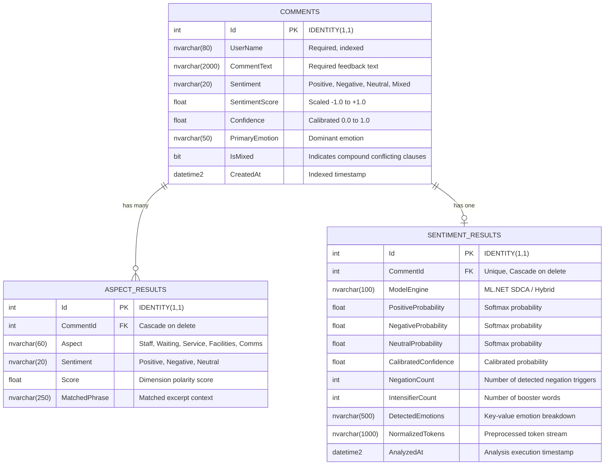

# Database Schema Documentation
## Database: ConsultationSentimentDB
**Engine:** Microsoft SQL Server LocalDB (`(localdb)\MSSQLLocalDB`)  
**ORM:** Entity Framework Core (.NET 8)

---

### Entity Relationship Diagram (ERD)

---

### Table Specifications

#### 1. `Comments` Table
| Column | Type | Constraints | Purpose |
|---|---|---|---|
| `Id` | `INT` | Primary Key, Identity | Unique consultation comment identifier |
| `UserName` | `NVARCHAR(80)` | NOT NULL | Client or practitioner name |
| `CommentText` | `NVARCHAR(2000)` | NOT NULL | Raw consultation feedback text |
| `Sentiment` | `NVARCHAR(20)` | NOT NULL, Indexed | Overall classification (*Positive, Negative, Neutral, Mixed*) |
| `SentimentScore`| `FLOAT` | NOT NULL, Default `0.0` | Polarity metric from `-1.0` (severe negative) to `+1.0` (strong positive) |
| `Confidence` | `FLOAT` | NOT NULL, Default `0.5` | Calibrated confidence score (`0.50` to `0.99`) |
| `PrimaryEmotion`| `NVARCHAR(50)` | NOT NULL, Default `'Neutral'`| Dominant detected emotion |
| `IsMixed` | `BIT` | NOT NULL, Default `0` | Boolean flag for compound mixed feedback |
| `CreatedAt` | `DATETIME2` | NOT NULL, Indexed | Timestamp of submission |

#### 2. `AspectResults` Table
| Column | Type | Constraints | Purpose |
|---|---|---|---|
| `Id` | `INT` | Primary Key, Identity | Unique aspect result identifier |
| `CommentId` | `INT` | Foreign Key (Cascade) | Parent consultation comment reference |
| `Aspect` | `NVARCHAR(60)` | NOT NULL, Indexed | Aspect name (*Staff Behaviour, Waiting Time, Service Quality, Facilities, Communication*) |
| `Sentiment` | `NVARCHAR(20)` | NOT NULL, Indexed | Polarity of this specific aspect |
| `Score` | `FLOAT` | NOT NULL, Default `0.0` | Numerical score for this aspect |
| `MatchedPhrase`| `NVARCHAR(250)`| NULL | Keyword match with clause excerpt |

#### 3. `SentimentResults` Table
| Column | Type | Constraints | Purpose |
|---|---|---|---|
| `Id` | `INT` | Primary Key, Identity | Unique analysis trace identifier |
| `CommentId` | `INT` | Foreign Key, Unique (Cascade)| One-to-one parent feedback reference |
| `ModelEngine` | `NVARCHAR(100)`| NULL | Diagnostic model identifier |
| `PositiveProbability` | `FLOAT` | NOT NULL | Softmax positive class probability |
| `NegativeProbability` | `FLOAT` | NOT NULL | Softmax negative class probability |
| `NeutralProbability` | `FLOAT` | NOT NULL | Softmax neutral class probability |
| `CalibratedConfidence` | `FLOAT` | NOT NULL | Composite calibrated confidence |
| `NegationCount` | `INT` | NOT NULL | Count of inverted polarity triggers |
| `IntensifierCount`| `INT` | NOT NULL | Count of booster words (*very, extremely*) |
| `DetectedEmotions` | `NVARCHAR(500)`| NULL | Serialization of emotion distribution |
| `NormalizedTokens`| `NVARCHAR(1000)`| NULL | Preprocessed text after contraction expansion |
| `AnalyzedAt` | `DATETIME2` | NOT NULL | Timestamp when analysis executed |

---

### Indexing & Performance Strategy
1. `IX_Comments_CreatedAt`: High-speed ordering and date-range filtering for trends and pagination.
2. `IX_Comments_Sentiment`: Instant aggregation for KPI cards and distribution charts.
3. `IX_AspectResults_Aspect`: Fast grouped aggregations across clinical dimensions.
4. `IX_AspectResults_Sentiment`: Fast retrieval of negative complaints and positive praises.
5. `FK_AspectResults_Comments` & `FK_SentimentResults_Comments`: Enforces relational integrity with `ON DELETE CASCADE`.
